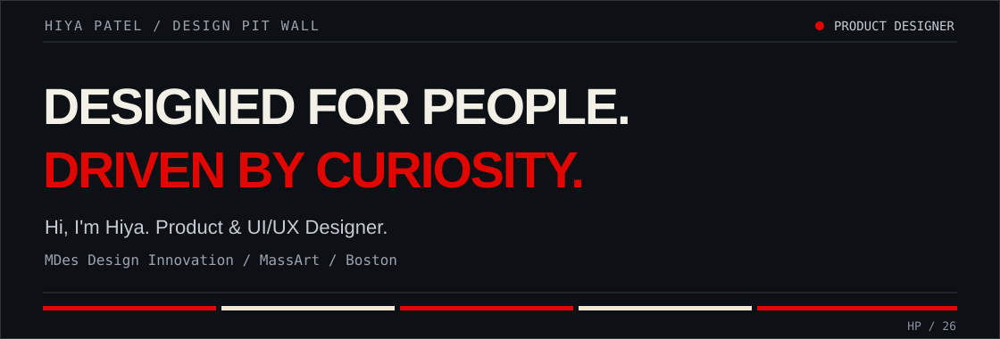

 

 

## ✦ 01 / THE PERSON BEHIND THE PIXELS

I’m **Hiya**, a product and UI/UX designer who believes good design starts with a better question.

I’m pursuing my **MDes in Design Innovation at MassArt & MAS/STS at MIT**, exploring the space where human behavior, technology, meaningful experiences meet.

I enjoy turning messy, complex problems into experiences that feel intuitive, useful, and a little unexpected. From research and systems thinking to prototypes and interactive websites, I care about **why** something should exist just as much as **how** it works.

> **My design philosophy:** Make it meaningful. Make it intuitive. Make people curious.

 

## 🏁 02 / ON THE GRID — SELECTED WORK

<table width="990">
<tr>
<td width="330" valign="top">
<a href="https://hiyaapatell.com/#project/paquet"><strong>📦 Paquet</strong></a> 
AR · Product Design
</td>
<td width="330" valign="top">
<a href="https://hiyaapatell.com/#project/massart"><strong>🎓 MassArt</strong></a> 
Service Design · UX Research
</td>
<td width="330" valign="top">
<a href="https://hiyaapatell.com/#project/hiddenboston"><strong>🏙️ Hidden Boston</strong></a> 
UI/UX · Development
</td>
</tr>
<tr>
<td width="330" valign="top">
<a href="https://hiyaapatell.com/#project/lepanthere"><strong>🐆 Le Panthère</strong></a> 
Website Redesign · UI/UX
</td>
<td width="330" valign="top">
<a href="https://hiyaapatell.com/#project/synesthesia"><strong>🎨 Synesthesia</strong></a> 
Creative Tools · Interaction
</td>
<td width="330" valign="top">
<a href="https://hiyaapatell.com"><strong>💻 Portfolio Website</strong></a> 
UI/UX · Development
</td>
</tr>
<tr>
<td width="330" valign="top">
<a href="https://github.com/hiyaapatell/between.nyc"><strong>🗺️ BETWEEN.NYC</strong></a> 
Interactive NYC Exploration
</td>
<td width="330" valign="top">
<a href="https://github.com/hiyaapatell/citypulse"><strong>🌆 CityPulse</strong></a> 
City Discovery · Web App
</td>
<td width="330" valign="top">
<a href="https://github.com/hiyaapatell/studyflow"><strong>📚 StudyFlow</strong></a> 
Study Dashboard · Focus Timer
</td>
</tr>
</table>

 

## 🔴 03 / HOW I WORK — THE DESIGN LAPS

**Question the obvious** → Understand real people → Explore possibilities → Put ideas in their hands → Learn and iterate.

I’m interested in the moments where *user needs*, *systems*, and *emerging technology* intersect. The best outcome isn’t just a polished screen. It’s a better experience.

 

## 💻 04 / THE TOOLKIT

### Design & Prototyping

    

### Development & Productivity

   

### Product & UX Design

        

### Research & Strategy

    

### Currently Exploring

   

 

## ⚡ 05 / CURRENTLY IN MOTION

| TRACK | WHAT I'M EXPLORING |
|:--|:--|
| 🧠 **Thesis track** | Lost intentions in students' digital behavior |
| ✦ **Product track** | RECALL — helping saved information become useful again |
| 🧩 **Experience track** | Research-driven digital experiences and interactive prototypes |
| 🏎️ **Creative track** | Bringing personality, playfulness, and precision into interfaces |

 

## ✉️ 06 / LET'S MAKE THE NEXT MOVE

### Good design starts with a better question.
**Have one worth exploring together?**

 

DESIGNED FOR PEOPLE. DRIVEN BY CURIOSITY. • HP / 26

