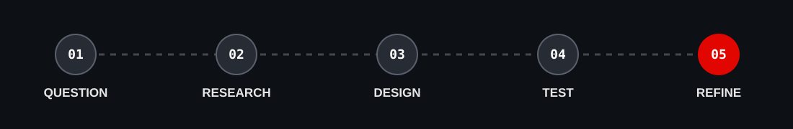

 

 

## ✦ 01 / THE PERSON BEHIND THE PIXELS

I’m **Hiya**, a product and UI/UX designer who believes good design starts with a better question.

I’m pursuing my **MDes in Design Innovation at MassArt & MAS/STS at MIT**, exploring the space where human behavior, technology, meaningful experiences meet.

I enjoy turning messy, complex problems into experiences that feel intuitive, useful, and a little unexpected. From research and systems thinking to prototypes and interactive websites, I care about **why** something should exist just as much as **how** it works.

> **My design philosophy:** Make it meaningful. Make it intuitive. Make people curious.

 

## 🏁 02 / ON THE GRID — SELECTED WORK

<table>
<tr>
<td width="33%" valign="top">

**[📦 Paquet](https://hiyaapatell.com)**

AR packaging · Product Design

</td>
<td width="33%" valign="top">

**[🎓 MassArt Service Design](https://hiyaapatell.com)**

Student journey · Service Design

</td>
<td width="33%" valign="top">

**[🏙️ Hidden Boston](https://hiyaapatell.com/#project/hiddenboston)**

City discovery · UI/UX

</td>
</tr>
<tr>
<td width="33%" valign="top">

**[🐆 Le Panthère](https://hiyaapatell.com)**

Website redesign · UX

</td>
<td width="33%" valign="top">

**[🎨 Synesthesia](https://hiyaapatell.com)**

Collaborative creativity · App Design

</td>
<td width="33%" valign="top">

**[📐 Angle App](https://hiyaapatell.com)**

Shopping experience · UI/UX

</td>
</tr>
<tr>
<td width="33%" valign="top">

**[🏎️ Portfolio Website](https://github.com/hiyaapatell/hiyapatel.portfolio)**

F1-inspired digital portfolio

</td>
<td width="33%" valign="top">

**[🗺️ BETWEEN.NYC](https://github.com/hiyaapatell/between.nyc)**

Interactive NYC exploration

</td>
<td width="33%" valign="top">

**[🌆 CityPulse](https://github.com/hiyaapatell/citypulse)**

Local discovery web app

</td>
</tr>
</table>

 

## 🔴 03 / HOW I WORK — THE DESIGN LAPS

**Question the obvious** → Understand real people → Explore possibilities → Put ideas in their hands → Learn and iterate.

I’m interested in the moments where *user needs*, *systems*, and *emerging technology* intersect. The best outcome isn’t just a polished screen. It’s a better experience.

 

## 🛠️ 04 / THE TOOLKIT

**Design & prototyping**

**Development & productivity**

**Design skills**

`Product Design` · `UI/UX` · `Interaction Design` · `Responsive Design` · `Information Architecture` · `User Flows` · `Wireframing` · `Prototyping` · `Design Systems`

**Research methods**

`User Interviews` · `Usability Testing` · `Competitive Analysis` · `Journey Mapping` · `Persona Development`

**Currently exploring**

`AI + Human Behavior` · `Context-Aware Experiences` · `Creative Technology` · `Digital Memory`

 

## ⚡ 05 / CURRENTLY IN MOTION

| TRACK | WHAT I'M EXPLORING |
|:--|:--|
| 🧠 **Thesis track** | Lost intentions in students' digital behavior |
| ✦ **Product track** | RECALL — helping saved information become useful again |
| 🧩 **Experience track** | Research-driven digital experiences and interactive prototypes |
| 🏎️ **Creative track** | Bringing personality, playfulness, and precision into interfaces |

 

## ✉️ 06 / LET'S MAKE THE NEXT MOVE

### Good design starts with a better question.
**Have one worth exploring together?**

 

DESIGNED FOR PEOPLE. DRIVEN BY CURIOSITY. • HP / 26

